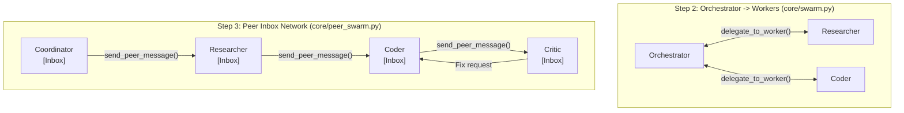

# Architecture & Engineering Handbook (`first-agent`)

This document explains **every architectural decision, design pattern, component, and module** in this project so you can understand how the system works under the hood, explain it in interviews, or pitch it to clients.

---

## 1. The Core Mental Model: "Brain" vs. "Harness"

Every AI agent system is made of two distinct halves:

1. **The Brain (The LLM Weights — e.g., `qwen3:8b`, `llama3`, Gemini, Claude)**
   - **Stateless & Passive**: Takes a list of messages in, predicts a single response (plain text or a tool-call request), and immediately forgets everything.
   - **Blind & Handless**: Cannot run code, browse the web, check the clock, read files, or loop on its own.
2. **The Harness (This Codebase)**
   - The software runtime wrapped around the LLM that gives it **memory, tools, budgets, multi-agent communication, and a `Think -> Act -> Observe` loop**.
   - On industry benchmarks (like SWE-bench), upgrading the **harness** while keeping the exact same model weights often doubles or triples task accuracy.

---

## 2. Key Architectural Decisions (And Why We Made Them)

### Decision 1: Hexagonal Architecture (Ports & Adapters via `Protocol`)
* **Problem**: Most agent tutorials hardcode `openai` or `sqlite3` inside the agent loop. When you want to switch to Hugging Face, Groq, or PostgreSQL later, you have to rewrite everything.
* **Solution**: We defined strict Python `Protocol` interfaces in `core/`:
  - [`LLMProvider`](core/llm.py): The swarm only calls `llm.generate(messages, tools)`.
  - [`StorageBackend`](core/storage.py): The swarm only calls `storage.save_tenant_memory(...)`, `storage.add_global_skill(...)`, etc.
  - [`EventBus`](core/bus.py): The swarm emits events without knowing whether a Terminal CLI or a Web UI is listening.

### Decision 2: Universal Primitives Instead of 1,000 Narrow Tools
* **Problem**: You cannot write a dedicated Python function for every possible task a user might ask.
* **Solution**: Alongside convenience tools (`get_weather`, `calculator`), we gave the swarm **universal primitives** in [`tools.py`](tools.py):
  - **`run_python`**: A sandboxed Python 3 subprocess (`15s` timeout, scoped to `workspace/`) that captures `STDOUT` and `STDERR`. If the swarm needs to analyze data or test an algorithm, it writes Python code on the fly, reads any error tracebacks, and self-corrects.
  - **`web_search` & `fetch_url`**: Zero-API-key internet search (via DuckDuckGo HTML) and HTML-to-text extraction using Python's built-in `HTMLParser`.

### Decision 3: Dual-Mode Tool Calling + Fast-Thinking Optimization
* **Problem**:
  1. Models like `qwen3:8b`, `llama3.1`, and GPT-4 support native OpenAI `tools=` API schemas, whereas base models like `llama3:latest` throw `400 Bad Request: does not support tools`.
  2. Reasoning models like `qwen3:8b` emit long `<think>...</think>` blocks on every routing hop, making a 5-step swarm take 2+ minutes locally.
* **Solution** ([`core/llm.py`](core/llm.py)):
  - **Auto-Fallback**: `OpenAICompatibleProvider` tries native tool calling first. If the model rejects `tools=`, it automatically switches to **ReAct JSON mode** (injecting JSON tool instructions into the system prompt and parsing `{"tool": ..., "args": ...}` from raw text).
  - **`/no_think` Fast Mode**: For `qwen3` models, `FAST_THINKING=true` automatically prepends `/no_think` and strips `<think>` tags, making multi-agent routing **5–10x faster** on local hardware.

### Decision 4: SQLite (`WAL` Mode) + Auto-Pruning vs. Heavy Cloud Databases
* **Problem**: How do we store memories, sessions, and traces for $0 without the `.db` file growing huge over time?
* **Solution** ([`core/storage.py`](core/storage.py)):
  - Uses Python's built-in `sqlite3` in **WAL (Write-Ahead Logging)** mode (`workspace/swarm.db`).
  - **Rule 1**: Binary/large files are written to `workspace/` on disk, never inside SQL rows.
  - **Rule 2**: `swarm_traces` and `tenant_sessions` have built-in **rolling TTL pruning** (keeping only the latest 500 traces and 30 turns per tenant), keeping `swarm.db` under a few megabytes forever.
  - When you deploy across multiple cloud containers later, you implement a `PostgresStorage` class matching `StorageBackend` in one file.

### Decision 5: Multi-Tenant Isolation + The `PrivacyAirlock`
* **Problem**: How can different clients' swarms learn from each other's runs **without ever leaking private client data**?
* **Solution** ([`core/storage.py`](core/storage.py)):
  We split knowledge into two strictly separated tables:
  1. **`tenant_memories` (Episodic / Private)**: Partitioned by `tenant_id` (`client_a` vs. `client_b`). Client B can never query Client A's facts.
  2. **`global_skills` (Procedural / Shared)**: Stores generic technical lessons (`category`, `problem_pattern`, `solution_rule`).
  - **The `PrivacyAirlock`**: Before any lesson enters `global_skills` (either via the `share_global_skill` tool or automatic error-recovery detection in [`WorkerAgent`](core/swarm.py)), `PrivacyAirlock.sanitize()` scrubs all emails (`<EMAIL>`), URLs (`<URL>`), IPv4 addresses (`<IP>`), API keys (`<SECRET>`), file paths (`<PATH>`), and 4+ digit numbers (`<NUM>`).

### Decision 6: Budget Guardrails Built In Before Peer Swarms
* **Problem**: Multi-agent networks can get stuck in polite loops or infinite retries, burning tokens or hanging local GPUs.
* **Solution** ([`core/budget.py`](core/budget.py)):
  - `BudgetTracker` is checked *before every single LLM call* (`check_and_increment_step`).
  - Enforces 4 hard caps: `max_swarm_steps`, `max_steps_per_agent`, `max_total_tokens`, and `max_wall_seconds`.

### Decision 7: Two Swarm Topologies (Step 2 Orchestrator vs. Step 3 Peer Inboxes)
We implemented **both** multi-agent architectures so you can compare and demo them side-by-side:



* **Step 2 (`OrchestratorSwarm` in [`core/swarm.py`](core/swarm.py))**: Hub-and-spoke. The `orchestrator` calls a worker like a function and waits for its return string. Simple and predictable, but the orchestrator is a bottleneck.
* **Step 3 (`PeerSwarm` in [`core/peer_swarm.py`](core/peer_swarm.py))**: Decentralized peer network. Every agent (`coordinator`, `researcher`, `coder`, `critic`) owns a FIFO `inbox` queue (`deque[PeerMessage]`). `researcher` can message `coder` directly, and `coder` can message `critic` for QA verification without routing back through `coordinator`.

### Decision 8: Decoupled Pub/Sub `EventBus` + Server-Sent Events (SSE) Cinema UI
* **Problem**: Plain chat boxes hide what a swarm is doing, while developer tracing tools (Langfuse/Phoenix) look like raw logs to clients.
* **Solution** ([`core/bus.py`](core/bus.py), [`server.py`](server.py), [`static/index.html`](static/index.html)):
  - Every action emits a `SwarmEvent` onto `EventBus`.
  - `server.py` streams those events over standard HTTP **Server-Sent Events (`/api/events`)** using Python's built-in `ThreadingHTTPServer` (zero extra dependencies).
  - `static/index.html` renders a real-time **HTML5 Canvas neural network graph** with glowing nodes, radar halos on the active agent, inbox queue badges, and animated particle packets flying between peers whenever messages are sent.

### Decision 9: Data-Driven `RoleRegistry` & Capability Bundles (`@web`, `@code`, `@files`)
* **Problem**: Hardcoding `researcher`, `coder`, and `critic` inside Python files makes adding new roles tedious and forces you to list individual tool names every time.
* **Solution** ([`core/roles.py`](core/roles.py)):
  - **Capability Bundles (`CAPABILITY_BUNDLES`)**: Groups atomic tools into reusable tags (`@web`, `@code`, `@files`, `@memory`, `@all`).
  - **Declarative `RoleRegistry` (`workspace/roles.json`)**: Both `OrchestratorSwarm` and `PeerSwarm` build their agents dynamically from `RoleRegistry`.
  - **3 Ways to Create Roles**:
    1. **Web UI (`➕ New Agent Role` modal)** or CLI (`/add-role`)
    2. **JSON Config (`workspace/roles.json`)**
    3. **On-the-Fly AI Recruiting (`spawn_specialist` tool)**: The Coordinator/Orchestrator can spin up a brand-new specialist role mid-run when a task requires new expertise, and the Canvas UI automatically spaces `N` nodes in a dynamic orbital arc.

---

## 3. Complete Module-by-Module Reference

| File | Responsibility | Key Classes / Functions |
| :--- | :--- | :--- |
| [`tools.py`](tools.py) | Atomic tool implementations & OpenAI JSON schemas | `calculator`, `get_current_time`, `get_weather`, `web_search`, `fetch_url`, `run_python`, `save_note`, `read_note`, `list_notes`, `TOOL_SCHEMAS` |
| [`core/bus.py`](core/bus.py) | Pub/Sub telemetry event bus | `SwarmEvent`, `EventBus.subscribe()`, `EventBus.emit()` |
| [`core/budget.py`](core/budget.py) | Step, token, and wall-clock guardrails | `BudgetConfig`, `BudgetTracker`, `BudgetExceededError` |
| [`core/storage.py`](core/storage.py) | Multi-tenant SQLite DB & PII scrubber | `StorageBackend`, `PrivacyAirlock.sanitize()`, `SQLiteStorage` |
| [`core/llm.py`](core/llm.py) | Model adapter + ReAct fallback + Qwen fast mode | `LLMProvider`, `OpenAICompatibleProvider`, `LLMResponse` |
| [`core/roles.py`](core/roles.py) | Declarative Role Registry & Capability Bundles | `CAPABILITY_BUNDLES`, `RoleSpec`, `RoleRegistry`, `make_spawn_specialist_tool()` |
| [`core/swarm.py`](core/swarm.py) | Worker loop + Step 2 Hub-and-Spoke Swarm | `WorkerAgent.execute_task()`, `OrchestratorSwarm.run()` |
| [`core/peer_swarm.py`](core/peer_swarm.py) | Step 3 Decentralized Inbox Network | `PeerMessage`, `PeerNode`, `PeerSwarm.run()` |
| [`agent.py`](agent.py) | Interactive Terminal CLI for both topologies | `main()`, `/roles`, `/add-role`, `/mode`, `/tenant`, `/memory`, `/skills` |
| [`server.py`](server.py) | Zero-dependency HTTP + Live SSE streaming server | `SwarmRequestHandler`, `/api/events`, `/api/roles`, `/api/run`, `/api/state` |
| [`static/index.html`](static/index.html) | Sci-Fi Mission Control Web Dashboard | Dynamic orbital Canvas graph, `+ New Agent Role` modal, Live SSE feed |

---

## 4. How to Swap Models (Ollama, Hugging Face, Groq, Gemini)

Because [`OpenAICompatibleProvider`](core/llm.py) uses the standard OpenAI chat/tools protocol, switching models requires **only changing `.env`**:

1. **Local Ollama (Default — 100% Free & Offline)**
   ```env
   API_BASE_URL=http://localhost:11434/v1
   API_KEY=ollama
   MODEL_NAME=qwen3:8b
   FAST_THINKING=true
   ```
2. **Hugging Face Serverless Inference Router (Free Tier)**
   ```env
   API_BASE_URL=https://router.huggingface.co/v1
   API_KEY=hf_your_token_here
   MODEL_NAME=Qwen/Qwen2.5-72B-Instruct
   ```
3. **Groq Cloud (Free Tier — Blazingly Fast for Live Client Demos)**
   ```env
   API_BASE_URL=https://api.groq.com/openai/v1
   API_KEY=gsk_your_key_here
   MODEL_NAME=llama-3.3-70b-versatile
   ```
4. **Google Gemini (Free Tier via AI Studio)**
   ```env
   API_BASE_URL=https://generativelanguage.googleapis.com/v1beta/openai/
   API_KEY=AIza_your_key_here
   MODEL_NAME=gemini-2.5-flash
   ```
