# Architecture & Engineering Handbook (Neural Swarm)

A comprehensive architectural reference covering the core design patterns, decoupled interfaces, data models, memory layers, and security mechanisms of Neural Swarm (`first-agent`).

---

## 1. Core Mental Model: "Brain" vs. "Harness"

1. **The Brain (LLM Backends — Ollama, Groq, Gemini, OpenAI, Claude)**:
   Stateless probabilistic token generators. They possess zero intrinsic abilities to run code, crawl the web, enforce tenant boundaries, persist state across crashes, or govern financial budgets.
2. **The Harness (This Codebase)**:
   The hardened operating environment wrapped around the models that manages **memory partitioning, sandboxed tools, budget governance, cryptographic checkpoints, multi-agent topologies, and self-improving distillation loops**.

---

## 2. Comprehensive Subsystem Architecture

```mermaid
flowchart TD
    subgraph Ingress["Client & Ingress Layer"]
        API["HTTP & SSE Server (server.py)"]
        CLI["Interactive CLI (agent.py)"]
        AUTH["AuthManager (core/auth.py)"]
        GOV["TenantCostGovernor & Limiter (core/rate_limiter.py)"]
    end

    subgraph Planning["Swarm Factory & Meta-Planning"]
        PLN["TaskDrivenMetaPlanner (core/meta_planner.py)"]
        VAL["SwarmGenerationValidator (core/meta_planner.py)"]
        FAC["Agent & Swarm Factory (core/factory.py)"]
        REG["Capability & Tool Registry (core/registry.py)"]
        TOP["TopologyRegistry (core/topology.py)"]
    end

    subgraph Execution["Swarm Execution & Runtime"]
        WRK["WorkerAgent Loop (core/swarm.py)"]
        RTR["ModelPolicyRouter (core/router.py)"]
        CB["CircuitBreaker & Resilience (core/resilience.py)"]
        APP["ApprovalGate (core/approval.py)"]
        HND["TypedHandoff M2M (core/handoffs.py)"]
        BUS["EventBus Telemetry (core/bus.py)"]
    end

    subgraph StateAndMemory["Durable State, Memory & Efficiency"]
        CHK["CheckpointStore & Idempotency (core/checkpoint.py)"]
        RET["Hybrid BM25 + Vector Retrieval (core/retrieval.py)"]
        SCR["Call-by-Reference Scratchpad (core/scratchpad.py)"]
        CMP["ContextCompactor (core/compaction.py)"]
        EXM["ExemplarStore (core/exemplars.py)"]
        PRF["ProfileStore (core/profiles.py)"]
        FDB["FeedbackStore (core/feedback.py)"]
        DST["SkillDistiller (core/distiller.py)"]
        OPT["PromptOptimizer (core/prompt_opt.py)"]
    end

    Ingress --> Planning --> Execution --> StateAndMemory
```



---

## 3. Module & Subsystem Reference

| Module | Core Classes & Interfaces | Architectural Responsibility |
| :--- | :--- | :--- |
| **[`core/resilience.py`](core/resilience.py)** | `CircuitBreaker`, `RetryConfig`, `retry_with_backoff` | 3-state circuit breaker (CLOSED, OPEN, HALF_OPEN) with randomized exponential jitter preventing cascading provider outages. |
| **[`core/telemetry.py`](core/telemetry.py)** | `UsageLedger`, `calculate_call_cost`, `PRICING_TABLE_V1` | Tracks exact per-call prompt/completion/cached tokens, latency ms, and calculates true USD cost backed by SQLite. |
| **[`core/security.py`](core/security.py)** | `TaintTracker`, `sanitize_untrusted_text`, `wrap_untrusted_content` | Enforces untrusted boundary delimiters, strips zero-width/tag injection characters, and blocks high-risk tools after web ingestion. |
| **[`core/rate_limiter.py`](core/rate_limiter.py)** | `TokenBucket`, `TenantCostGovernor` | Thread-safe token bucket rate limiting, active concurrency tracking, and rolling 24-hour USD spend caps per tenant. |
| **[`core/registry.py`](core/registry.py)** | `ToolMetadata`, `ToolRegistry`, `DynamicRoleSpec` | Pure data-driven capability catalog declaring `risk_class`, `side_effects`, and `data_classification` with zero hardcoded personas. |
| **[`core/topology.py`](core/topology.py)** | `BaseTopology`, `OrchestratorTopology`, `PeerTopology`, `PipelineTopology`, `ReviewLoopTopology` | Pluggable multi-agent coordination architectures replacing procedural branching with clean, decoupled topology drivers. |
| **[`core/factory.py`](core/factory.py)** | `SwarmSpec`, `AgentFactory`, `SwarmFactory` | Instantiates arbitrary agent swarms from declarative specs with multi-tenant isolation and client mass-assignment protection. |
| **[`core/approval.py`](core/approval.py)** | `ApprovalGate`, `ApprovalRequest`, `ApprovalDecision` | Single-use cryptographic approval tokens with action/arg SHA-256 hash binding, TTL timeouts, and append-only audit logging. |
| **[`core/meta_planner.py`](core/meta_planner.py)** | `TaskDrivenMetaPlanner`, `SwarmGenerationValidator` | Decomposes raw missions into optimal swarms with structured repair loops and strict privilege ceilings. |
| **[`core/mission.py`](core/mission.py)** | `IntegratedMissionRunner`, `MissionExecutionResult` | Unified vertical slice orchestrating Planner -> Factory -> Topology -> ApprovalGate -> CheckpointStore. |
| **[`core/retrieval.py`](core/retrieval.py)** | `HybridRetrievalStore`, `EmbeddingProvider`, `BM25Partition` | Multi-tenant hybrid retrieval fusing Okapi BM25 and pre-normalized dot-product dense embeddings via Reciprocal Rank Fusion ($k=60$). |
| **[`core/prompt_layout.py`](core/prompt_layout.py)** | `CacheStablePromptBuilder`, `FinalTurnPolicy` | Three-Tier prompt layout (Immutable Prefix, Semi-Static Body, Dynamic Tail) providing deterministic prefix stability for KV-cache reuse. |
| **[`core/cleaning.py`](core/cleaning.py)** | `MarkdownHTMLDistiller`, `summarize_code_output` | Strips navigation, footers, scripts, and hidden CSS text; bounds huge stdout dumps to head/tail while preserving stack traces verbatim. |
| **[`core/handoffs.py`](core/handoffs.py)** | `TypedHandoff`, `HandoffValidator` | Compact, versioned JSON Schemas for inter-agent communication (`task_delegation_v1`, `specialist_finding_v1`, `review_critique_v1`). |
| **[`core/router.py`](core/router.py)** | `ModelPolicyRouter`, `RoutingLLMProvider`, `ProviderProfile` | Enforces tenant data residency jurisdictions (`local`, `us`, `eu`, `apac`), provider allow-lists, and policy-compliant fallback chains. |
| **[`core/checkpoint.py`](core/checkpoint.py)** | `CheckpointStore`, `MissionCheckpoint`, `IdempotencyRegistry`, `DurableMissionRunner` | Step-level mission state persistence with HMAC-SHA256 signatures, tenant re-authorization on resume, and idempotent side-effect deduplication. |
| **[`core/scratchpad.py`](core/scratchpad.py)** | `ScratchpadStore`, `ScratchpadPointer`, `ScratchpadItem` | Out-of-band store for bulky payloads using 128-bit random tokens, zero filesystem paths, tenant quotas, and taint preservation. |
| **[`core/compaction.py`](core/compaction.py)** | `ContextCompactor`, `CompactionResult` | Batched observation compaction into digests with restorable pointers, reducing context by >50% while protecting system prompts. |
| **[`core/exemplars.py`](core/exemplars.py)** | `ExemplarStore`, `Exemplar` | Curated in-context demonstrations with an administrative approval gate, PII scrubbing, user scoping, and untrusted framing. |
| **[`core/profiles.py`](core/profiles.py)** | `ProfileStore`, `UserProfile` | User preferences with schema allow-lists, length caps, HTML escaping, and code-level security primacy. |
| **[`core/feedback.py`](core/feedback.py)** | `FeedbackStore`, `PointwiseFeedback`, `PreferencePair` | Pointwise ratings (+1/-1) and pairwise preference sets with mandatory training consent verification and PII scrubbing. |
| **[`core/distiller.py`](core/distiller.py)** | `SkillDistiller`, `DistilledSkill` | Post-mission background skill extraction requiring explicit success signals, planted injection rejection, and strict capability matching. |
| **[`core/prompt_opt.py`](core/prompt_opt.py)** | `PromptOptimizer`, `PromptArtifact` | Versioned prompt optimization over `dev` splits with single-pass evaluation gating on frozen `test` splits and spend caps. |
| **[`tools.py`](tools.py)** | `run_python`, `fetch_url`, `calculator`, `save_note`, `read_note`, etc. | Hardened, sandboxed tool primitives with AST validation, SSRF DNS pinning, and tenant directory partitioning. |
| **[`benchmarks/`](benchmarks/)** | `runner.py`, `smoke_tasks.json`, `reports/baseline-v0.json` | Calibrated smoke benchmark suite spanning 4 domain packs with deterministic verification. |

---

## 4. Security Invariants Matrix

```
+-----------------------------------------------------------------------------------------+
| Security Control                 | Enforcing Module         | Verification Test Suite   |
+----------------------------------+--------------------------+---------------------------+
| Container Execution Sandboxing   | tools.py                 | test_tools.py             |
| SSRF & TOCTOU DNS Pinning        | tools.py                 | test_tools.py             |
| AST Math Safe Evaluation         | tools.py                 | test_tools.py             |
| Multi-Tenant Directory Boundary  | tools.py                 | test_tools.py             |
| Multi-Tenant DB Partitioning     | core/storage.py          | test_storage.py           |
| Cross-Swarm PII Airlock          | core/storage.py          | test_privacy_airlock.py   |
| API Constant-Time Auth & RBAC    | core/auth.py             | test_auth.py              |
| Untrusted Delimiters & Taint     | core/security.py         | test_security_taint.py    |
| Financial Bounds & Token Spends  | core/rate_limiter.py     | test_rate_limiter.py      |
| Cryptographic Action Approvals   | core/approval.py         | test_approval.py          |
| Over-Privilege Ceiling Check     | core/meta_planner.py     | test_factory_and_planner  |
| BM25/Vector Tenant Isolation     | core/retrieval.py        | test_retrieval.py         |
| Cache-Stable Prefix Layout       | core/prompt_layout.py    | test_prompt_layout.py     |
| Hidden HTML Distillation         | core/cleaning.py         | test_cleaning.py          |
| M2M Schema Validation & XSS Safe | core/handoffs.py         | test_handoffs.py          |
| Data Residency Jurisdiction Rule | core/router.py           | test_router.py            |
| HMAC-SHA256 State Integrity      | core/checkpoint.py       | test_checkpoint.py        |
| Idempotent Side-Effect Recovery  | core/checkpoint.py       | test_checkpoint.py        |
| 128-Bit Opaque Scratchpad Ref    | core/scratchpad.py       | test_scratchpad_and_...   |
| Compaction Trust Inheritance     | core/compaction.py       | test_scratchpad_and_...   |
| Few-Shot Admin Approval Gate     | core/exemplars.py        | test_exemplars_profile... |
| Code-Level Invariant Primacy     | core/profiles.py         | test_exemplars_profile... |
| Contractual Training Consent     | core/feedback.py         | test_exemplars_profile... |
| Zero Signature-Leak Distillation | core/distiller.py        | test_distiller_and_...    |
| Frozen Test Split Quarantine     | core/prompt_opt.py       | test_distiller_and_...    |
+-----------------------------------------------------------------------------------------+
```
