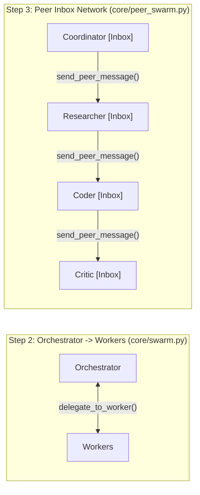

# Architecture & Engineering Handbook (Neural Swarm)

A concise reference covering the core design patterns, decoupled interfaces, configuration system, and security architecture of Neural Swarm (`first-agent`).

---

## 1. Core Mental Model: "Brain" vs. "Harness"

1. **The Brain (LLM Weights — `qwen3:8b`, `llama3`, Gemini, Groq)**: Stateless text/tool predictor. Cannot execute code, browse the web, persist state, or loop on its own.
2. **The Harness (This Codebase)**: The runtime wrapped around the model providing **memory, tools, budgets, multi-agent communication, and a `Think -> Act -> Observe` loop**.

---

## 2. Key Architectural Decisions

### 1. Hexagonal Architecture (Loose Coupling via `Protocol`)
All swarm engines depend only on abstract interfaces in `core/`, never concrete implementations:
- **[`LLMProvider`](core/llm.py)**: `llm.generate(messages, tools)` — swap Ollama, Groq, Gemini, Hugging Face, or `ScriptedMockLLM` with zero changes to swarm code.
- **[`StorageBackend`](core/storage.py)**: `save_tenant_memory`, `add_global_skill`, `append_session_turn`, `log_trace` — swap SQLite for Postgres in one class.
- **[`EventBus`](core/bus.py)**: Decoupled Pub/Sub bus (`bus.subscribe` / `bus.emit`). Swarms emit events without knowing whether the CLI, SSE Web Server, or Eval Runner is listening.

### 2. Zero Hardcoding: Layered Configuration ([`config/settings.json`](config/settings.json) + [`core/config.py`](core/config.py))
Every timeout, budget limit, database path, capability bundle (`@web`, `@code`, `@files`, `@memory`), and coordinator/orchestrator prompt template lives in [`config/settings.json`](config/settings.json), with seed specialist roles in [`config/default_roles.json`](config/default_roles.json). Environment variables in `.env` override JSON defaults via [`SwarmConfig`](core/config.py).

### 3. Dual-Mode Tool Calling + Qwen3 Fast Mode ([`core/llm.py`](core/llm.py))
- **Auto-Fallback**: `OpenAICompatibleProvider` attempts native OpenAI `tools=` calling first and automatically falls back to **ReAct JSON prompting** if a model rejects tool schemas.
- **`/no_think` Optimization**: Prepends `/no_think` for `qwen3` models when `fast_thinking=true`, cutting local multi-agent routing latency by 5–10x.

### 4. Two Swarm Topologies ([`core/swarm.py`](core/swarm.py) vs. [`core/peer_swarm.py`](core/peer_swarm.py))

- **Step 2 (`OrchestratorSwarm`)**: Central hub delegates tasks and synthesizes results.
- **Step 3 (`PeerSwarm`)**: Decentralized peer network where each specialist owns a FIFO `deque[PeerMessage]` inbox and hands off work directly to peers (`yield_on_tools=["send_peer_message", "finish_swarm"]`).

### 5. Declarative `RoleRegistry` & Capability Bundles ([`core/roles.py`](core/roles.py))
Roles are data-driven (`RoleSpec`) and use capability tags (`@web`, `@code`, `@files`, `@memory`, `@all`) instead of hardcoded tool lists. New roles can be created via `config/default_roles.json`, the Web UI (`+ New Role`), the CLI (`/add-role`), or autonomously mid-run by the AI (`spawn_specialist`).

---

## 3. Security Architecture & Threat Mitigations

| Layer | Threat / Vector | Mitigation Implemented |
| :--- | :--- | :--- |
| **Network (`fetch_url`)** | Server-Side Request Forgery (SSRF) and TOCTOU DNS Rebinding to localhost, internal LAN, or cloud metadata (`169.254.169.254`) | `_resolve_and_validate_public_url()` paired with `_pinned_getaddrinfo()` in [`tools.py`](tools.py) pins socket resolution to the validated public IP, disables redirects, and blocks loopback/private/link-local/reserved IPs. |
| **Subprocess (`run_python`)** | Container escape, system execution, or exfiltration of `API_KEY` or cloud tokens via `os.environ` | Container sandboxing (Docker/Podman with `--network none`, `--read-only`, non-root, scrubbed env) or fail-closed logic unless `CONFIG.unsafe_allow_local_exec` is True. `_get_sandbox_env()` in [`tools.py`](tools.py) strips all env vars matching `KEY`, `TOKEN`, `SECRET`, `PASSWORD`, `AUTH`, or `CREDENTIAL`. |
| **Math (`calculator`)** | Arbitrary code execution (`eval`), stack recursion, or CPU/RAM Denial-of-Service (`factorial(10000000)`, `999999 ** 999999`) | Whitelisted `ast` node evaluator in [`tools.py`](tools.py) + `_safe_pow()` enforcing `calc_max_exponent` (`1000`), bounded combinatorics (`_safe_factorial`, `_safe_comb`, `_safe_perm` for $n \le 1000$), and 300-character expression limit. |
| **Filesystem (`save_note`/`read_note`)** | Path traversal (`../../`), multi-tenant file collision, or overwriting system state (`keys.json`, `swarm.db`) | Scoped to `workspace/tenants/{tenant_id}/`, verifies `Path.resolve().relative_to(WORKSPACE_DIR.resolve())`, and explicitly blocks system metadata files (`keys.json`, `swarm.db*`, `swarms.json`, `roles.json`, `memory.json`, `.env*`). |
| **Multi-Tenant DB (`SQLiteStorage`)** | Cross-tenant memory leakage, SQL injection, or PII leakage into shared skills | Parameterized SQL queries with composite indexes, strict regex `validate_tenant_id()` validation (`^[A-Za-z0-9_-]{1,64}$`), rolling row pruning, and [`PrivacyAirlock.sanitize()`](core/storage.py) scrubbing `<EMAIL>`, `<URL>`, `<IP>`, `<SECRET>`, `<PATH>`, and `<NUM>`. |
| **API Authentication & Scoped RBAC (`core/auth.py`, `server.py`)** | Unauthenticated API access, token brute-force timing attacks, horizontal privilege escalation, concurrent race conditions | `AuthManager` with SHA-256 hash checks via `hmac.compare_digest`, scoped access (`admin` vs `user`), cryptographically random fallback key generation, per-tenant run locking (`_tenant_run_locks`), and non-loopback host binding refusal unless auth is active. |
| **Telemetry Streaming (`server.py`)** | Cross-tenant SSE stream telemetry eavesdropping | `SSEClientConnection` and `_broadcast_event` partition live event dispatch strictly by `tenant_id` (admin credentials receive all events). |
| **Web Server & UI (`server.py`, `index.html`)** | DOM XSS from untrusted web/tool output, clickjacking, or memory exhaustion via giant POST bodies | `escapeHtml()` & `safeColor()` in [`static/index.html`](static/index.html); `max_body_bytes` (`64 KB`) cap, `X-Content-Type-Options: nosniff`, and `X-Frame-Options: DENY` in [`server.py`](server.py). |
| **Swarm Runtime (`BudgetTracker`)** | Runaway agent loops or unbounded token spend | [`BudgetTracker`](core/budget.py) enforces `max_swarm_steps`, `max_steps_per_agent`, `max_total_tokens`, and `max_wall_seconds` before every LLM call, with real-time budget synchronization in [`SwarmManager.get_last_budget()`](core/swarm_manager.py). |

---

## 4. Module Reference

| File | Responsibility |
| :--- | :--- |
| [`config/settings.json`](config/settings.json) | Central JSON configuration for LLM, budgets, storage, tools, server, capability bundles, and system prompts |
| [`config/default_roles.json`](config/default_roles.json) | Default seed specialist roles (`architect`, `coder`, `test_runner`, `critic`, `researcher`, `security_reviewer`) |
| [`config/default_keys.json`](config/default_keys.json) | Default seed hashed API keys for role-scoped authentication (`admin` and tenant keys) |
| [`core/config.py`](core/config.py) | `SwarmConfig` loader merging `config/settings.json` with `.env` overrides |
| [`core/auth.py`](core/auth.py) | `AuthManager` with constant-time verification (`hmac.compare_digest`), scope validation, and key hashing |
| [`core/bus.py`](core/bus.py) | `EventBus` & `SwarmEvent` pub/sub telemetry |
| [`core/budget.py`](core/budget.py) | `BudgetConfig`, `BudgetTracker`, `BudgetExceededError` |
| [`core/storage.py`](core/storage.py) | `StorageBackend`, `SQLiteStorage` (WAL mode + auto-pruning), `PrivacyAirlock` |
| [`core/llm.py`](core/llm.py) | `LLMProvider`, `OpenAICompatibleProvider` (native tools + ReAct fallback + Qwen `/no_think`) |
| [`core/roles.py`](core/roles.py) | `RoleSpec`, `RoleRegistry`, capability bundle resolver, `spawn_specialist` tool factory |
| [`core/swarm.py`](core/swarm.py) | `WorkerAgent` execution loop & Step 2 `OrchestratorSwarm` |
| [`core/peer_swarm.py`](core/peer_swarm.py) | Step 3 `PeerSwarm` decentralized FIFO inbox network |
| [`core/swarm_manager.py`](core/swarm_manager.py) | Multi-swarm deployment, cross-swarm bridge (`send_external_swarm_message`), and egress DLP filtering |
| [`tools.py`](tools.py) | Hardened atomic & universal tools + OpenAI JSON schemas |
| [`agent.py`](agent.py) | Interactive multi-tenant CLI supporting both `peer` and `orchestrator` topologies |
| [`server.py`](server.py) | Zero-dependency HTTP + Live SSE streaming backend with scoped API-key authentication |
| [`static/index.html`](static/index.html) | Web-based Event Dashboard UI with HTML5 Canvas swarm graph visualizer and auth management |
| [`evals.py`](evals.py) | Step 5 deterministic evaluation, regression & security audit suite (11 checks) |
| [`frameworks_comparison.py`](frameworks_comparison.py) | Step 6 side-by-side LangGraph (`StateGraph`) & OpenAI Agents SDK (`SDKRunner`) equivalence |

---

## 5. Step 6: Framework Equivalence Mapping ([`frameworks_comparison.py`](frameworks_comparison.py))

| Concept | Custom Implementation | Framework Equivalent |
| :--- | :--- | :--- |
| **Single-Agent Tool Loop** | [`WorkerAgent.execute_task()`](core/swarm.py) | LangChain `AgentExecutor` / Claude Agent SDK |
| **Hub-and-Spoke Delegation** | [`OrchestratorSwarm`](core/swarm.py) (`delegate_to_worker`) | Anthropic Subagents / CrewAI Hierarchical |
| **Stateful Graph Routing** | [`PeerSwarm`](core/peer_swarm.py) + [`StateGraph`](frameworks_comparison.py) | **LangGraph** (`StateGraph`, `add_node`, `add_conditional_edges`)* |
| **Decentralized Handoffs** | `yield_on_tools=["send_peer_message"]` + [`SDKRunner`](frameworks_comparison.py) | **OpenAI Agents SDK** (`Agent(handoffs=[...])`, `Runner.run_sync`)* |
| **Persistence & Memory** | [`SQLiteStorage`](core/storage.py) + [`PrivacyAirlock`](core/storage.py) | LangGraph `SqliteSaver` + `BaseStore` |
| **Observability** | [`EventBus`](core/bus.py) + [`server.py`](server.py) SSE Stream | LangSmith / Langfuse / Arize Phoenix |

*\*Note on Framework Scope: The lightweight `StateGraph` (~45 LOC) and `SDKRunner` (~35 LOC) in `frameworks_comparison.py` illustrate state-machine dispatch and agent handoffs. Production LangGraph adds durable checkpointer time-travel, parallel superstep reducers, and human-in-the-loop interrupts; the OpenAI Agents SDK supports non-OpenAI models via LiteLLM or OpenAI-compatible gateways.*
