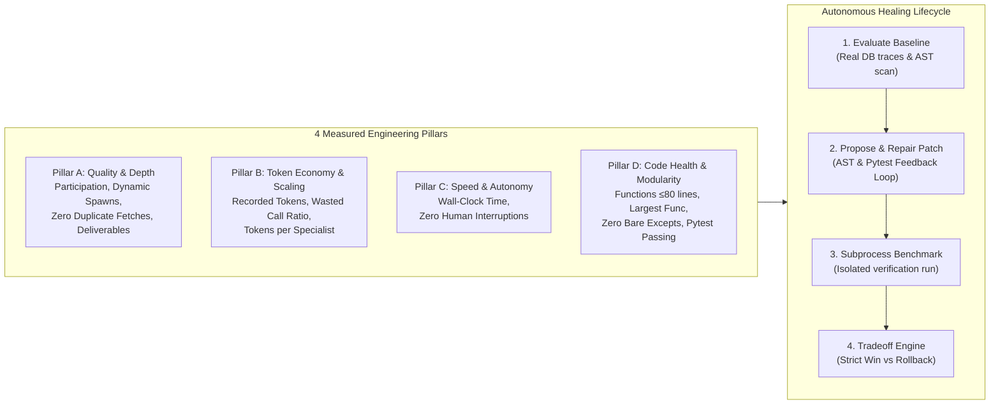

# Architecture & Engineering Handbook (Neural Swarm)

A comprehensive architectural reference covering the core design patterns, decoupled interfaces, data models, memory layers, and security mechanisms of Neural Swarm (`first-agent`).

---

## 1. Core Mental Model: "Brain" vs. "Harness"

1. **The Brain (LLM Backends — Ollama, Groq, Gemini, OpenAI, Claude)**:
   Stateless probabilistic token generators. They possess zero intrinsic abilities to run code, crawl the web, enforce tenant boundaries, persist state across crashes, or govern financial budgets.
2. **The Harness (This Codebase)**:
   The hardened operating environment wrapped around the models that manages **memory partitioning, sandboxed tools, budget governance, cryptographic checkpoints, multi-agent topologies, and self-improving distillation loops**.

---

## 2. Comprehensive Subsystem Architecture

```mermaid
flowchart TD
    subgraph Ingress["Client & Ingress Layer"]
        API["HTTP & SSE Server (server.py)"]
        CLI["Interactive CLI (agent.py)"]
        AUTH["AuthManager (core/auth.py)"]
        GOV["TenantCostGovernor & Limiter (core/rate_limiter.py)"]
    end

    subgraph Planning["Swarm Factory & Meta-Planning"]
        PLN["TaskDrivenMetaPlanner (core/meta_planner.py)"]
        VAL["SwarmGenerationValidator (core/meta_planner.py)"]
        FAC["Agent & Swarm Factory (core/factory.py)"]
        REG["Capability & Tool Registry (core/registry.py)"]
        TOP["TopologyRegistry (core/topology.py)"]
    end

    subgraph Execution["Swarm Execution & Runtime"]
        WRK["WorkerAgent Loop (core/swarm.py)"]
        RTR["ModelPolicyRouter (core/router.py)"]
        CB["CircuitBreaker & Resilience (core/resilience.py)"]
        APP["ApprovalGate (core/approval.py)"]
        HND["TypedHandoff M2M (core/handoffs.py)"]
        BUS["EventBus Telemetry (core/bus.py)"]
    end

    subgraph StateAndMemory["Durable State, Memory & Efficiency"]
        CHK["CheckpointStore & Idempotency (core/checkpoint.py)"]
        RET["Hybrid BM25 + Vector Retrieval (core/retrieval.py)"]
        SCR["Call-by-Reference Scratchpad (core/scratchpad.py)"]
        CMP["ContextCompactor (core/compaction.py)"]
        EXM["ExemplarStore (core/exemplars.py)"]
        PRF["ProfileStore (core/profiles.py)"]
        FDB["FeedbackStore (core/feedback.py)"]
        DST["SkillDistiller (core/distiller.py)"]
        OPT["PromptOptimizer (core/prompt_opt.py)"]
    end

    subgraph SelfHealing["Evidence-Based 4-Pillar Self-Healer"]
        ENG["ScorecardEngine (core/self_healer.py)"]
        PROP["FixProposer & Interactive Repair (core/self_healer.py)"]
        GIT["GitSafetyController & Rollback (core/self_healer.py)"]
        HEAL["SelfHealer Runtime (core/self_healer.py)"]
        OPT_ROLE["system_optimizer & @self_heal (tools.py)"]
    end

    Ingress --> Planning --> Execution --> StateAndMemory
    StateAndMemory --> SelfHealing
```



---

## 3. Module & Subsystem Reference

| Module | Core Classes & Interfaces | Architectural Responsibility |
| :--- | :--- | :--- |
| **[`core/resilience.py`](core/resilience.py)** | `CircuitBreaker`, `RetryConfig`, `retry_with_backoff` | 3-state circuit breaker (CLOSED, OPEN, HALF_OPEN) with randomized exponential jitter preventing cascading provider outages. |
| **[`core/telemetry.py`](core/telemetry.py)** | `UsageLedger`, `calculate_call_cost`, `PRICING_TABLE_V1` | Tracks exact per-call prompt/completion/cached tokens, latency ms, and calculates true USD cost backed by SQLite. |
| **[`core/security.py`](core/security.py)** | `TaintTracker`, `sanitize_untrusted_text`, `wrap_untrusted_content` | Enforces untrusted boundary delimiters, strips zero-width/tag injection characters, and blocks high-risk tools after web ingestion. |
| **[`core/rate_limiter.py`](core/rate_limiter.py)** | `TokenBucket`, `TenantCostGovernor` | Thread-safe token bucket rate limiting, active concurrency tracking, and rolling 24-hour USD spend caps per tenant. |
| **[`core/registry.py`](core/registry.py)** | `ToolMetadata`, `ToolRegistry`, `DynamicRoleSpec` | Pure data-driven capability catalog declaring `risk_class`, `side_effects`, and `data_classification` with zero hardcoded personas. |
| **[`core/topology.py`](core/topology.py)** | `BaseTopology`, `OrchestratorTopology`, `PeerTopology`, `PipelineTopology`, `ReviewLoopTopology` | Pluggable multi-agent coordination architectures replacing procedural branching with clean, decoupled topology drivers. |
| **[`core/factory.py`](core/factory.py)** | `SwarmSpec`, `AgentFactory`, `SwarmFactory` | Instantiates arbitrary agent swarms from declarative specs with multi-tenant isolation and client mass-assignment protection. |
| **[`core/approval.py`](core/approval.py)** | `ApprovalGate`, `GLOBAL_APPROVAL_GATE`, `ApprovalRecord` | Live interactive human approval gate pausing `WorkerAgent.execute_task` on high-risk tools, with SHA-256 argument binding, UI/CLI resolution (`POST /api/approvals/resolve`), and single-use token burn. |
| **[`core/meta_planner.py`](core/meta_planner.py)** | `TaskDrivenMetaPlanner`, `SwarmGenerationValidator` | Decomposes raw missions into optimal swarms using native function-calling structured output (`emit_structured_output`) with repair loops and strict privilege ceilings. |
| **[`core/mission.py`](core/mission.py)** | `IntegratedMissionRunner`, `MissionExecutionResult` | Default execution pipeline (`POST /api/missions/execute`, Web UI, and `agent.py`) orchestrating Planner -> Factory -> Topology -> Live ApprovalGate -> Step-by-Step HMAC CheckpointStore, with deterministic mission scope isolation (`clean_tenant="system"` on self-heal tasks). |
| **[`core/peer_swarm.py`](core/peer_swarm.py)** | `PeerSwarm`, `PeerNode`, `PeerMessage` | Decentralized peer mesh network with point-to-point inboxes, parallel fan-out scheduler, exhausted-peer protection, and anti-hallucination remote remediation gate. |
| **[`core/self_healer.py`](core/self_healer.py)** | `ScorecardEngine`, `FixProposer`, `GitSafetyController`, `SelfHealer` | Evidence-based 4-pillar scorecard evaluation (Quality, Tokens, Speed, Code), LLM diagnosis with interactive test-repair loops, isolated verification missions, and strict tradeoff gating. |
| **[`core/retrieval.py`](core/retrieval.py)** | `HybridRetrievalStore`, `EmbeddingProvider`, `BM25Partition` | Multi-tenant hybrid retrieval fusing Okapi BM25 and pre-normalized dot-product dense embeddings via Reciprocal Rank Fusion ($k=60$). |
| **[`core/prompt_layout.py`](core/prompt_layout.py)** | `CacheStablePromptBuilder`, `FinalTurnPolicy` | Three-Tier prompt layout (Immutable Prefix, Semi-Static Body, Dynamic Tail) providing deterministic prefix stability for KV-cache reuse. |
| **[`core/cleaning.py`](core/cleaning.py)** | `MarkdownHTMLDistiller`, `summarize_code_output` | Strips navigation, footers, scripts, and hidden CSS text; bounds huge stdout dumps to head/tail while preserving stack traces verbatim. |
| **[`core/handoffs.py`](core/handoffs.py)** | `TypedHandoff`, `HandoffValidator` | Compact, versioned JSON Schemas for inter-agent communication (`task_delegation_v1`, `specialist_finding_v1`, `review_critique_v1`). |
| **[`core/router.py`](core/router.py)** | `ModelPolicyRouter`, `RoutingLLMProvider`, `ProviderProfile` | Enforces tenant data residency jurisdictions (`local`, `us`, `eu`, `apac`), provider allow-lists, and policy-compliant fallback chains. |
| **[`core/checkpoint.py`](core/checkpoint.py)** | `CheckpointStore`, `MissionCheckpoint`, `IdempotencyRegistry`, `DurableMissionRunner` | Step-level mission state persistence with HMAC-SHA256 signatures, tenant re-authorization on resume, and idempotent side-effect deduplication. |
| **[`core/scratchpad.py`](core/scratchpad.py)** | `ScratchpadStore`, `ScratchpadPointer`, `ScratchpadItem` | Out-of-band store for bulky payloads using 128-bit random tokens, zero filesystem paths, tenant quotas, and taint preservation. |
| **[`core/compaction.py`](core/compaction.py)** | `ContextCompactor`, `CompactionResult` | Batched observation compaction into digests with restorable pointers, reducing context by >50% while protecting system prompts. |
| **[`core/exemplars.py`](core/exemplars.py)** | `ExemplarStore`, `Exemplar` | Curated in-context demonstrations with an administrative approval gate, PII scrubbing, user scoping, and untrusted framing. |
| **[`core/profiles.py`](core/profiles.py)** | `ProfileStore`, `UserProfile` | User preferences with schema allow-lists, length caps, HTML escaping, and code-level security primacy. |
| **[`core/feedback.py`](core/feedback.py)** | `FeedbackStore`, `PointwiseFeedback`, `PreferencePair` | Pointwise ratings (+1/-1) and pairwise preference sets with mandatory training consent verification and PII scrubbing. |
| **[`core/distiller.py`](core/distiller.py)** | `SkillDistiller`, `DistilledSkill` | Post-mission background skill extraction requiring explicit success signals, planted injection rejection, and strict capability matching. |
| **[`core/prompt_opt.py`](core/prompt_opt.py)** | `PromptOptimizer`, `PromptArtifact` | Versioned prompt optimization over `dev` splits with single-pass evaluation gating on frozen `test` splits and spend caps. |
| **[`tools.py`](tools.py)** | `run_python`, `fetch_url`, `calculator`, `save_note`, `read_note`, `scorecard_diagnose`, `self_heal_codebase` | Hardened, sandboxed tool primitives with AST validation, pure file-reading blocker, SSRF DNS pinning, tenant directory partitioning, and first-class `@self_heal` capabilities. |
| **[`benchmarks/`](benchmarks/)** | `runner.py`, `smoke_tasks.json`, `reports/baseline-v0.json` | Calibrated smoke benchmark suite spanning 4 domain packs with deterministic verification. |

---

## 4. Security Invariants Matrix

```
+-----------------------------------------------------------------------------------------+
| Security Control                 | Enforcing Module         | Verification Test Suite   |
+----------------------------------+--------------------------+---------------------------+
| Container Execution Sandboxing   | tools.py                 | test_tools.py             |
| SSRF & TOCTOU DNS Pinning        | tools.py                 | test_tools.py             |
| AST Math Safe Evaluation         | tools.py                 | test_tools.py             |
| Multi-Tenant Directory Boundary  | tools.py                 | test_tools.py             |
| Multi-Tenant DB Partitioning     | core/storage.py          | test_storage.py           |
| Cross-Swarm PII Airlock          | core/storage.py          | test_privacy_airlock.py   |
| API Constant-Time Auth & RBAC    | core/auth.py             | test_auth.py              |
| Untrusted Delimiters & Taint     | core/security.py         | test_security_taint.py    |
| Financial Bounds & Token Spends  | core/rate_limiter.py     | test_rate_limiter.py      |
| Cryptographic Action Approvals   | core/approval.py         | test_approval.py          |
| Over-Privilege Ceiling Check     | core/meta_planner.py     | test_factory_and_planner  |
| BM25/Vector Tenant Isolation     | core/retrieval.py        | test_retrieval.py         |
| Cache-Stable Prefix Layout       | core/prompt_layout.py    | test_prompt_layout.py     |
| Hidden HTML Distillation         | core/cleaning.py         | test_cleaning.py          |
| M2M Schema Validation & XSS Safe | core/handoffs.py         | test_handoffs.py          |
| Data Residency Jurisdiction Rule | core/router.py           | test_router.py            |
| HMAC-SHA256 State Integrity      | core/checkpoint.py       | test_checkpoint.py        |
| Idempotent Side-Effect Recovery  | core/checkpoint.py       | test_checkpoint.py        |
| 128-Bit Opaque Scratchpad Ref    | core/scratchpad.py       | test_scratchpad_and_...   |
| Compaction Trust Inheritance     | core/compaction.py       | test_scratchpad_and_...   |
| Few-Shot Admin Approval Gate     | core/exemplars.py        | test_exemplars_profile... |
| Code-Level Invariant Primacy     | core/profiles.py         | test_exemplars_profile... |
| Contractual Training Consent     | core/feedback.py         | test_exemplars_profile... |
| Zero Signature-Leak Distillation | core/distiller.py        | test_distiller_and_...    |
| Frozen Test Split Quarantine     | core/prompt_opt.py       | test_distiller_and_...    |
| AST Pure File-Read Sandbox Guard | tools.py                 | test_tools.py             |
| Mission Scope & Tenant Isolation | core/mission.py          | test_vertical_slice.py    |
| Remote Anti-Hallucination Gate    | core/peer_swarm.py       | test_peer_inbox.py        |
| Self-Healer Immutable Judge Gate | core/self_healer.py      | test_self_healer.py       |
| Git Tagged Rollback on Regression| core/self_healer.py      | test_self_healer.py       |
+-----------------------------------------------------------------------------------------+
```

---

## 5. 4-Pillar Engineering Scorecard & Autonomous Self-Healing Subsystem

The Self-Healing engine ([`core/self_healer.py`](core/self_healer.py)) provides empirical ground truth and autonomous code improvement across 4 holistic pillars:



### 5.1 The 4-Pillar Metric Framework
1. **Pillar A: Quality & Depth (0-100)**: Measures active specialist participation, dynamic recruitment from discovery, elimination of duplicate resource fetches, absence of file-read tool misuse, verbatim evidence density, and complete deliverable delivery.
2. **Pillar B: Token Economy & Scaling (0-100)**: Measures serialized token logging in checkpoints, minimal wasted tool calls ($\le 5\%$), and token efficiency per specialist.
3. **Pillar C: Speed & Autonomy (0-100)**: Measures end-to-end mission wall-clock latency and complete freedom from unnecessary human approval interruptions.
4. **Pillar D: Code Health & Modularity (0-100)**: Measures code maintainability via AST analysis (functions $\le 80$ lines $\ge 98\%$, largest function $\le 150$ lines), zero bare except handlers, zero unhandled server tracebacks, and 100% green test suite.

### 5.2 Deterministic Safety & Anti-Gaming Invariants
- **Immutable Judge & Boundary**: The self-healer can only edit safe application code (`core/*`, `tools.py`, `server.py`, `agent.py`, `static/index.html`). It is strictly prohibited from modifying security modules (`core/security.py`, `core/auth.py`, `core/approval.py`), test suites (`tests/`), guidelines, `.env`, or itself (`core/self_healer.py`).
- **Interactive Test-Repair Loop**: When an LLM-proposed edit breaks a test or has a search block mismatch, the healer does not immediately abandon the fix. It feeds the failure traceback back into `FixProposer.repair()` (up to 2 retry attempts) to self-correct before reverting.
- **Process Isolation Boundary**: All verification missions run in isolated child subprocesses (`agent.py`). This guarantees that modified Python files are freshly compiled from disk without memory pollution, and child crashes cannot take down the supervisor.
- **Tradeoff Engine**: Evaluates multidimensional tradeoffs. Commits code only when the composite score strictly improves without quality regressions or token bloat.

### 5.3 First-Class Swarm Task Integration (`@self_heal`)
Self-healing is not restricted to an admin modal; it is exposed directly to the swarm:
- **`scorecard_diagnose(mission_id)`**: Tool returning human-readable 4-pillar scores and open rule violations.
- **`self_heal_codebase(max_fixes, verify, rules)`**: Tool triggering a complete autonomous healing cycle with isolated verification and Git commit/rollback.
- **`system_optimizer`**: Built-in specialist role registered in `config/default_roles.json` equipped with `["@self_heal", "@code", "@files", "@memory"]`.

---

## 6. Planned Roadmap: Intent Expansion, Interactive Plan Preview & Mission Playbooks

To keep the core execution loop (`TaskDrivenMetaPlanner` $\rightarrow$ `SwarmFactory` $\rightarrow$ `BaseTopology` $\rightarrow$ `ApprovalGate` $\rightarrow$ `CheckpointStore`) deterministic and easy to debug while making mission dispatch effortless for end users, the next planned UX/Planning enhancements are:

1. **Interactive Plan Preview ("Approve Mission Plan" Mode)**:
   - Before executing specialist turns, allow the user to optionally inspect and edit the `SwarmSpec` generated by `TaskDrivenMetaPlanner` (topology, specialist roster, capabilities, and initial test vectors) from a 1-sentence goal.
2. **One-Click UI Mission Playbook Chips**:
   - Provide domain-agnostic starter chips above the command input bar (`Web & Security Audit`, `Codebase QA & Refactor`, `Data & Financial Analysis`, `Red-Team Probe`) that populate clean, 1-sentence mission goals without overriding dynamic role capabilities.
3. **Per-Role Model Routing Activation (FP-04 Integration)**:
   - Route `TaskDrivenMetaPlanner` and `critic` verification steps to a higher-reasoning model tier while keeping high-frequency worker tool steps on fast, low-cost Flash models.

