# Neural Swarm — Modular Multi-Agent AI Harness & Swarm Operating Engine

A first-principles, loosely-coupled multi-agent AI engineering platform and swarm runtime in Python featuring **Task-Driven Meta-Planning**, **Pluggable Topologies (Orchestrator, Peer Network, Linear Pipeline, Review Loop)**, **Cryptographic Human Approval Gates**, **Hybrid BM25 + Vector Retrieval**, **Multi-Tenant State Checkpointing & Resumption**, **Per-Role Model Routing & Data Residency**, and an **Autonomous Skill Distillation Pipeline**.

Built with zero heavy framework dependencies so every layer of the agent harness is transparent, testable, and swappable.

---

## Architecture Highlights

```mermaid
flowchart TD
    subgraph Foundation["1. Foundation & Safety (Phase A)"]
        CB["CircuitBreaker & Resilience (core/resilience.py)"]
        TEL["Pricing Table & Usage Ledger (core/telemetry.py)"]
        SMK["Smoke Benchmark Suite (benchmarks/)"]
        SAN["AST & Hardened Execution (tools.py)"]
        TNT["TaintTracker & Delimiters (core/security.py)"]
        GOV["TokenBucket & CostGovernor (core/rate_limiter.py)"]
    end

    subgraph SwarmCore["2. Generic Swarm Architecture (Phase B)"]
        REG["Capability & Tool Registry (core/registry.py)"]
        TOP["Pluggable Topologies (core/topology.py)"]
        FAC["Agent & Swarm Factory (core/factory.py)"]
        APP["Cryptographic Approval Gates (core/approval.py)"]
        PLN["Task-Driven Meta-Planner (core/meta_planner.py)"]
    end

    subgraph RetrievalEff["3. Retrieval & Efficiency (Phase C)"]
        HYB["Hybrid BM25 & Dense RRF Store (core/retrieval.py)"]
        LAY["Cache-Stable Prompt Layout (core/prompt_layout.py)"]
        CLN["HTML Distiller & Output Summarizer (core/cleaning.py)"]
        HND["Typed Machine Handoffs (core/handoffs.py)"]
        RTR["Data Residency & Provider Router (core/router.py)"]
        CHK["HMAC Checkpoints & Resumption (core/checkpoint.py)"]
    end

    subgraph MemorySelf["4. Memory & Self-Improvement (Phase D)"]
        SCR["Call-by-Reference Scratchpad (core/scratchpad.py)"]
        CMP["Restorable Context Compactor (core/compaction.py)"]
        EXM["Dynamic Exemplar Memory (core/exemplars.py)"]
        PRF["User Profiles & Preferences (core/profiles.py)"]
        FDB["Feedback Log & Preference Pairs (core/feedback.py)"]
        DST["Background Skill Distiller (core/distiller.py)"]
        OPT["Prompt Optimization Loop (core/prompt_opt.py)"]
    end

    Foundation --> SwarmCore --> RetrievalEff --> MemorySelf
```



### Architecture & Wiring Status

The codebase is organized into **Active Runtime Pipelines** and **Modular Subsystem Libraries**:

#### 1. Integrated Active Pipelines (Runtime-Wired)
- **Multi-Tenant Server & Telemetry UI ([`server.py`](server.py))**: Constant-time API key auth (`hmac.compare_digest`), scope RBAC (`admin` vs `user`), tenant isolation, strict security headers (CSP, HSTS, X-Content-Type-Options), and cross-tenant SSE event segregation.
- **Unified Vertical Slice ([`core/mission.py`](core/mission.py))**: An end-to-end mission pipeline connecting **TaskDrivenMetaPlanner** $\rightarrow$ **SwarmFactory** $\rightarrow$ **BaseTopology** execution $\rightarrow$ **ApprovalGate** (with cryptographically random single-use tokens) $\rightarrow$ **CheckpointStore** (with HMAC-SHA256 signature verification).
- **Multi-Agent Topologies ([`core/swarm.py`](core/swarm.py), [`core/peer_swarm.py`](core/peer_swarm.py), [`core/topology.py`](core/topology.py))**: Central orchestrator and decentralized peer inbox topologies with dynamic role recruitment and message routing.
- **Security-Hardened Primitives ([`tools.py`](tools.py))**: AST-whitelisted arithmetic calculator, SSRF firewall blocking RFC-1918 private IPs and cloud metadata endpoints, path-traversal prevention, and containerized Python execution (fail-closed when container runtime is absent unless explicit unsafe local execution is configured).

#### 2. Standalone Component Libraries (Unit Tested)
The following modules provide tested capabilities with rigorous unit test suites, available for programmatic integration:
- **[`core/router.py`](core/router.py)**: Central policy router enforcing jurisdiction allow-lists (`local`, `us`, `eu`, `apac`) and provider contractual constraints with policy-filtered fallback chains.
- **[`core/scratchpad.py`](core/scratchpad.py) & [`core/compaction.py`](core/compaction.py)**: Out-of-band bulky observation storage using 128-bit random opaque tokens and restorable observation digests.
- **[`core/exemplars.py`](core/exemplars.py), [`core/profiles.py`](core/profiles.py), [`core/feedback.py`](core/feedback.py)**: Approved few-shot exemplar pools, schema-bounded user profiles, and training consent enforcement.
- **[`core/distiller.py`](core/distiller.py) & [`core/prompt_opt.py`](core/prompt_opt.py)**: Autonomous skill distillation with capability matching, kill-switch protection, and prompt optimization evaluated across train/dev/test splits.
- **[`core/retrieval.py`](core/retrieval.py)**: Multi-tenant hybrid retrieval combining Okapi BM25 and vector embeddings with Reciprocal Rank Fusion (RRF).

---

## Security Invariants & Hardening Controls

The engine implements defense-in-depth controls across all execution paths:
- **33 Security Findings Remediated & Documented** in [`SECURITY_FINDINGS.md`](SECURITY_FINDINGS.md).
- **38 Quantitative Metrics & Measured Benchmarks** tracked in [`PROBLEMS_AND_METRICS.md`](PROBLEMS_AND_METRICS.md).
- **Core Security Controls**:
  - Container execution sandbox with fail-closed local execution default.
  - SSRF & DNS resolution validation blocking loopback and private networks.
  - Multi-tenant SQLite database and filesystem isolation with case folding and reserved device name rejection.
  - Constant-time API key verification (`hmac.compare_digest`) via `Authorization: Bearer` headers (rejecting query-string tokens).
  - Cryptographically random human approval tokens (`secrets.token_urlsafe(32)`) with single-use consumption and argument binding.
  - HMAC-SHA256 checkpoint verification requiring configured HMAC secrets.

---

## Quickstart

```bash
# 1. Environment Setup
python -m venv .venv
.\.venv\Scripts\activate
pip install -r requirements.txt
pip install -r requirements-dev.txt
cp .env.example .env

# 2. Run Complete Pytest Suite (127 tests, 82% coverage)
pytest --cov=core --cov=tools

# 3. Run Multi-Domain Smoke Benchmark Suite (10 tasks across 4 domain packs)
python benchmarks/runner.py

# 4. Launch Live Web Telemetry Dashboard (http://127.0.0.1:8000)
python server.py

# 5. Interactive Terminal Swarm CLI
python agent.py -m peer -t client_alpha
```

Read **[ARCHITECTURE.md](ARCHITECTURE.md)** for detailed module references, protocol definitions, and data models.
