# Neural Swarm — Modular Multi-Agent AI Harness & Swarm Operating Engine

A first-principles, loosely-coupled multi-agent AI engineering platform and swarm runtime in Python featuring **Task-Driven Meta-Planning**, **Pluggable Topologies (Orchestrator, Peer Network, Linear Pipeline, Review Loop)**, **Cryptographic Human Approval Gates**, **Hybrid BM25 + Vector Retrieval**, **Multi-Tenant State Checkpointing & Resumption**, **Per-Role Model Routing & Data Residency**, and an **Autonomous Skill Distillation Pipeline**.

Built with zero heavy framework dependencies so every layer of the agent harness is transparent, testable, and swappable.

---

## Architecture Highlights

```mermaid
flowchart TD
    subgraph Foundation["1. Foundation & Safety (Phase A)"]
        CB["CircuitBreaker & Resilience (core/resilience.py)"]
        TEL["Pricing Table & Usage Ledger (core/telemetry.py)"]
        SMK["Smoke Benchmark Suite (benchmarks/)"]
        SAN["AST & Hardened Execution (tools.py)"]
        TNT["TaintTracker & Delimiters (core/security.py)"]
        GOV["TokenBucket & CostGovernor (core/rate_limiter.py)"]
    end

    subgraph SwarmCore["2. Generic Swarm Architecture (Phase B)"]
        REG["Capability & Tool Registry (core/registry.py)"]
        TOP["Pluggable Topologies (core/topology.py)"]
        FAC["Agent & Swarm Factory (core/factory.py)"]
        APP["Cryptographic Approval Gates (core/approval.py)"]
        PLN["Task-Driven Meta-Planner (core/meta_planner.py)"]
    end

    subgraph RetrievalEff["3. Retrieval & Efficiency (Phase C)"]
        HYB["Hybrid BM25 & Dense RRF Store (core/retrieval.py)"]
        LAY["Cache-Stable Prompt Layout (core/prompt_layout.py)"]
        CLN["HTML Distiller & Output Summarizer (core/cleaning.py)"]
        HND["Typed Machine Handoffs (core/handoffs.py)"]
        RTR["Data Residency & Provider Router (core/router.py)"]
        CHK["HMAC Checkpoints & Resumption (core/checkpoint.py)"]
    end

    subgraph MemorySelf["4. Memory & Self-Improvement (Phase D)"]
        SCR["Call-by-Reference Scratchpad (core/scratchpad.py)"]
        CMP["Restorable Context Compactor (core/compaction.py)"]
        EXM["Dynamic Exemplar Memory (core/exemplars.py)"]
        PRF["User Profiles & Preferences (core/profiles.py)"]
        FDB["Feedback Log & Preference Pairs (core/feedback.py)"]
        DST["Background Skill Distiller (core/distiller.py)"]
        OPT["Prompt Optimization Loop (core/prompt_opt.py)"]
    end

    Foundation --> SwarmCore --> RetrievalEff --> MemorySelf
```



### Key Subsystems

1. **Autonomous Task-Driven Meta-Planning ([`core/meta_planner.py`](core/meta_planner.py), [`core/factory.py`](core/factory.py))**:
   - Decomposes arbitrary tasks into optimal roles, registered capabilities, topologies, and step/token budgets.
   - Enforces a deterministic `SwarmGenerationValidator` preventing privilege escalation and mass assignment.
2. **Pluggable Topologies ([`core/topology.py`](core/topology.py))**:
   - `orchestrator`: Central hub dispatching to specialists and synthesizing findings.
   - `peer`: Decentralized inbox network with FIFO message queues and dynamic handoffs.
   - `pipeline`: Sequential stage-by-stage data transformation.
   - `review_loop`: Generator-Critic iterative convergence loop.
3. **Resilience, Cost & Rate Governance ([`core/resilience.py`](core/resilience.py), [`core/rate_limiter.py`](core/rate_limiter.py), [`core/telemetry.py`](core/telemetry.py))**:
   - 3-state `CircuitBreaker` (CLOSED $\rightarrow$ OPEN $\rightarrow$ HALF_OPEN) with randomized exponential jitter.
   - Multi-tenant `TokenBucket` request limiter, concurrency tracking, and rolling 24h spend caps.
   - `UsageLedger` recording token consumption and exact USD costs per turn.
4. **Data Residency & Model Routing ([`core/router.py`](core/router.py))**:
   - Central policy router enforcing jurisdiction allow-lists (`local`, `us`, `eu`, `apac`) and provider contractual constraints.
   - Policy-filtered fallback chains that guarantee 0 compliance leaks during provider outages.
5. **Durable State, HMAC Checkpoints & Idempotency ([`core/checkpoint.py`](core/checkpoint.py))**:
   - Step-level mission checkpoints protected with HMAC-SHA256 tamper-evident signatures.
   - Tenant re-authorization on mission resumption.
   - Per-tenant `IdempotencyRegistry` guaranteeing **zero duplicate side effects** across fault recovery.
6. **Out-of-Band Memory & Restorable Compaction ([`core/scratchpad.py`](core/scratchpad.py), [`core/compaction.py`](core/compaction.py))**:
   - Bulky tool outputs are stored out-of-band and passed via 128-bit opaque tokens (`secrets.token_hex(16)`).
   - Zero filesystem path mapping; immune to directory traversal.
   - Aging observations are batch-compacted into digests with restorable pointers, reducing context tokens by **>50%**.
7. **Curated Exemplars, Profiles & Feedback ([`core/exemplars.py`](core/exemplars.py), [`core/profiles.py`](core/profiles.py), [`core/feedback.py`](core/feedback.py))**:
   - In-context exemplars require admin approval before becoming active.
   - User profiles enforce schema allow-lists, length bounds, and code-level invariant primacy.
   - Contractual consent gating on training dataset export.
8. **Experiential Learning & Prompt Optimization ([`core/distiller.py`](core/distiller.py), [`core/prompt_opt.py`](core/prompt_opt.py))**:
   - Background skill distillation requiring verified mission success signals.
   - Capability-signature keying ensures skills are **never injected into roles lacking required capabilities**.
   - Systematic prompt optimization evaluated on `dev` splits and promoted strictly via single-pass frozen `test` splits.

---

## Security Invariants & Audit Status

The engine has undergone comprehensive threat modeling and security auditing across all proposals:
- **33 Security Findings Remediated & Documented** in [`SECURITY_FINDINGS.md`](SECURITY_FINDINGS.md).
- **38 Quantitative Metrics & Performance Improvements** tracked in [`PROBLEMS_AND_METRICS.md`](PROBLEMS_AND_METRICS.md).
- **Zero-Bypass Guarantees**:
  - Container and subprocess execution sandboxing.
  - SSRF & TOCTOU DNS rebinding firewall.
  - Multi-tenant SQLite and directory isolation.
  - Constant-time API key verification (`hmac.compare_digest`).
  - Cryptographic human approval tokens with single-use burn and SHA-256 argument binding.

---

## Quickstart

```bash
# 1. Environment Setup
python -m venv .venv
.\.venv\Scripts\activate
pip install -r requirements.txt
pip install -r requirements-dev.txt
cp .env.example .env

# 2. Run Complete Pytest Suite (127 tests, 82% coverage)
pytest --cov=core --cov=tools

# 3. Run Multi-Domain Smoke Benchmark Suite (10 tasks across 4 domain packs)
python benchmarks/runner.py

# 4. Launch Live Web Telemetry Dashboard (http://127.0.0.1:8000)
python server.py

# 5. Interactive Terminal Swarm CLI
python agent.py -m peer -t client_alpha
```

Read **[ARCHITECTURE.md](ARCHITECTURE.md)** for detailed module references, protocol definitions, and data models.
