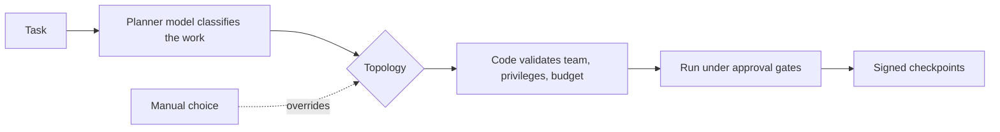

# Neural Swarm

Give it any task, and it designs the agent team to match. A multi-agent runtime in plain Python, built without an agent framework so every layer can be read, tested, and replaced.

```text
"What is 15% of 240?"                    -> one agent
"Summarise, translate, then format"      -> a pipeline of three
"Draft an abstract to review standards"  -> a writer and a reviewer
"Compare cost, nutrition, and storage"   -> a coordinator and three specialists
```

Try the selection path offline, with no API key:

```bash
python demo.py
```

The demo uses a scripted model, so it shows the plumbing rather than model quality.

## How the swarm is chosen



The model decides how the work is shaped. Code turns that into a topology and enforces the rules.

| The work is | Topology | Team size |
| :-- | :-- | :-- |
| One indivisible job | `single` | 1 |
| Separate independent parts | `orchestrator` | 1-6 |
| Stages that build on each other | `pipeline` | 2-6 |
| One artifact, drafted and improved | `review_loop` | 2 |
| Specialists who must exchange findings | `peer` | 3-6 |

Roles are invented per task, in the field's own terms, and receive only the capabilities the plan gives them. To choose a topology yourself, use `-m` in the CLI, the selector in the UI, or `mode` in the API. A manual choice always wins.

## Security

Rules that must hold are enforced in code, not in prompts:

- **Tenant isolation:** tenant identity comes from the API key, never from the request.
- **Human approval:** high-risk tool calls need a single-use approval bound to the exact arguments.
- **Taint tracking:** after a mission reads untrusted content, its high-risk tools need approval.
- **Privilege ceiling:** planned and runtime-spawned roles can't exceed an allow-list.
- **Code execution:** `run_python` runs in a container with no network, and is disabled if no container runtime exists.
- **Web access:** `fetch_url` refuses private addresses and cloud metadata endpoints.
- **Learned skills:** shared skills reach agents only after an admin approves them.

Details, including corrections to earlier claims, are in [SECURITY_FINDINGS.md](SECURITY_FINDINGS.md).

## Evidence

No result yet shows that the swarm beats a single agent. [`benchmarks/compare.py`](benchmarks/compare.py) measures exactly that, on 30 paired tasks across 11 subject areas, and hasn't been run on a live model. The committed smoke baseline measures one worker agent, not a swarm; [benchmarks/README.md](benchmarks/README.md) explains the difference.

## Quickstart

Requires Python 3.11 or later.

```bash
python -m venv .venv
source .venv/bin/activate        # Windows: .venv\Scripts\activate
pip install -r requirements.txt -r requirements-dev.txt
cp .env.example .env             # add your LLM key

pytest                           # offline, uses a mock LLM
python server.py                 # Web UI at http://127.0.0.1:8000
python agent.py                  # interactive CLI
python agent.py --plan -p "Plan a three-day trip to Lisbon"   # review the team first
```

## Project layout

| Path | Contents |
| :-- | :-- |
| `core/` | Planner, topologies, swarm runtime, approvals, storage, security |
| `swarm_tools/` | Tool implementations, one module per concern (`tools.py` is the registry) |
| `experimental/` | Tested modules with no runtime path yet |
| `benchmarks/` | Smoke suite and the swarm vs. single-agent comparison |
| `config/` | Prompts, seed roles, capability bundles |
| `static/` | Web UI |
| `tests/` | Unit, integration, and end-to-end tests, all offline |

## Further reading

- [ARCHITECTURE.md](ARCHITECTURE.md): modules, data flow, invariants
- [FUTURE_PLANS.md](FUTURE_PLANS.md): roadmap
- [PROBLEMS_AND_METRICS.md](PROBLEMS_AND_METRICS.md): engineering log

## License

[MIT](LICENSE)
